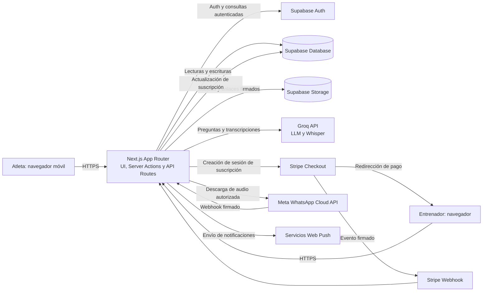

# Memoria técnica de H-Flow

## 1. Resumen ejecutivo

H-Flow es una aplicación web para la gestión de entrenamientos y el seguimiento de atletas. La solución se construye con Next.js App Router y React, utiliza Supabase para autenticación, persistencia y almacenamiento, y conecta servicios externos para capacidades de inteligencia artificial y pagos.

La aplicación separa las interfaces de entrenadores y atletas, valida la identidad y el rol de los usuarios y ejecuta operaciones sensibles en el servidor. Las rutas de API y Server Actions coordinan consultas a Supabase y llamadas a proveedores externos como Groq y Stripe. También se contemplan integraciones con Meta WhatsApp y Web Push.

La arquitectura prioriza la entrega rápida de una aplicación web integrada y la reducción de infraestructura propia. Las operaciones de lectura y escritura se apoyan en Supabase; los procesos de inteligencia artificial se ejecutan mediante peticiones HTTPS; y los eventos externos se reciben en endpoints específicos.

Este informe describe la arquitectura observada en el código. No se dispone de resultados de pruebas de carga ni de métricas de producción; por ello, el análisis de rendimiento es cualitativo y define indicadores para una evaluación posterior.

## 2. Alcance y tecnologías

| Capa | Tecnología | Responsabilidad |
|---|---|---|
| Interfaz | Next.js App Router, React y Tailwind CSS | Portal de entrenadores, portal de atletas y componentes interactivos |
| Ejecución web | Next.js en Node.js | Renderizado, Server Actions, endpoints HTTP y recepción de webhooks |
| Identidad | Supabase Auth | Autenticación y gestión de sesión |
| Persistencia | Supabase Database | Perfiles, rutinas, asignaciones, métricas y tareas |
| Archivos | Supabase Storage | Almacenamiento de archivos vinculados a la actividad del usuario |
| Inteligencia artificial | Groq API | Respuestas del asistente y transcripción de audios |
| Pagos | Stripe Checkout y Stripe Webhooks | Suscripciones recurrentes de entrenadores |
| Mensajería | Meta WhatsApp y Web Push | Entrada de mensajes de audio y notificaciones a atletas |

## 3. Diagrama de arquitectura de red

El navegador no recibe claves de servicio ni credenciales privadas de proveedores. Las peticiones privilegiadas se realizan desde el servidor. Las solicitudes de usuario autenticado utilizan el cliente Supabase de servidor, que propaga la sesión en cookies; las operaciones que necesitan privilegios administrativos emplean la clave de servicio únicamente en endpoints de servidor.

## 4. Arquitectura y responsabilidades

### 4.1 Capa de presentación

Las páginas y componentes de React presentan la información de la rutina, los reportes y las herramientas de entrenador. Los componentes interactivos se marcan como Client Components cuando necesitan estado local, eventos del navegador o APIs web. El portal del atleta adapta la presentación a pantallas móviles.

### 4.2 Capa de aplicación

Next.js agrupa la interfaz y la lógica de servidor:

- **Server Actions** ejecutan mutaciones y consultas iniciadas desde la aplicación, por ejemplo la consulta de métricas de cumplimiento.
- **API Routes** reciben solicitudes JSON, integraciones externas y webhooks.
- **Middleware** realiza comprobaciones tempranas de sesión, rol y estado de suscripción. Las operaciones sensibles deben mantener autorización en sus propias acciones y endpoints; el middleware no constituye por sí solo la frontera de seguridad de los datos.

### 4.3 Datos y archivos

Supabase almacena perfiles, atletas, rutinas asignadas, métricas y tareas. Las políticas de acceso de la base de datos deben complementar las comprobaciones de aplicación. Supabase Storage conserva archivos y puede proporcionar enlaces firmados para recursos privados; los permisos del bucket y sus políticas deben limitar el acceso a los propietarios autorizados.

### 4.4 Servicios externos

Groq procesa solicitudes de chat y transcripciones. Stripe aloja el formulario de pago y envía eventos al webhook configurado. Meta comunica eventos de WhatsApp y facilita la descarga autorizada del audio. Web Push distribuye avisos a los dispositivos registrados.

## 5. Flujos de datos asíncronos

### 5.1 Consulta del asistente del atleta

1. El cliente envía una pregunta a `POST /api/client-chat`.
2. El endpoint verifica la sesión y confirma que el perfil tiene rol de atleta.
3. La rutina asignada y el plan nutricional se consultan en paralelo a Supabase.
4. El servidor construye el contexto con esos datos y envía una petición a Groq.
5. Groq devuelve la respuesta y el endpoint la entrega al cliente.

La llamada al proveedor tiene un límite de espera de 20 segundos. Los errores de proveedor se devuelven como respuestas explícitas; las respuestas no se transmiten en streaming en la implementación revisada.

### 5.2 Audio entrante de WhatsApp

1. Meta verifica la URL del webhook mediante el desafío de suscripción.
2. Para eventos POST, el endpoint verifica la firma HMAC del cuerpo y limita el tamaño del evento.
3. El servidor solicita a Meta los metadatos del audio, valida el dominio y descarga el archivo con límites de tamaño y tiempo.
4. El audio se envía a Whisper de Groq para obtener una transcripción.
5. La transcripción se entrega al flujo interno de sincronización de WhatsApp.

La operación es asíncrona en el modelo de ejecución de Node.js, pero se procesa de forma síncrona respecto a la respuesta HTTP del webhook. Los mensajes de audio se procesan secuencialmente. Por tanto, un evento con varios audios puede tardar más y depender de los tiempos combinados de Meta y Groq.

### 5.3 Notificaciones de nuevo microciclo

El entrenador inicia la acción de publicación. El endpoint verifica el rol, carga los atletas y sus suscripciones push y envía las notificaciones concurrentemente. `Promise.allSettled` permite recoger resultados individuales; las suscripciones caducadas se eliminan. El estado actual no utiliza una cola externa, por lo que la solicitud permanece abierta mientras se completan los envíos.

### 5.4 Checkout y confirmación de suscripción

El servidor crea una sesión Stripe Checkout en modo recurrente y añade el identificador del entrenador a los metadatos. El navegador se redirige a Stripe. Tras el pago, Stripe envía `checkout.session.completed`; el webhook verifica la firma con el secreto configurado y marca `profiles.is_subscribed` como verdadero para el perfil de entrenador correspondiente.

La confirmación de suscripción depende del webhook firmado y no de la URL de retorno del navegador, lo que separa el estado de pago de la navegación del usuario.

### 5.5 Revisión de inactividad

El endpoint de cron exige un secreto de autorización, consulta atletas por páginas y agrupa identificadores para recuperar métricas y entrenamientos completados. Después calcula la última actividad y crea tareas de seguimiento con una operación idempotente basada en el identificador de tarea.

### 5.6 Check-in y vídeos de ejecución

El atleta envía peso, horas de sueño, estrés y fatiga mediante una Server Action autenticada, que valida el rol y persiste las métricas en Supabase. Para vídeos de series, la Server Action comprueba que la sesión y el ejercicio pertenecen al atleta autenticado, sube el archivo al bucket privado `athlete-set-videos` y registra la ruta de Storage junto con la asignación y el ejercicio en `athlete_set_videos`. El enlace firmado devuelto es temporal; la ruta de Storage persistida es la referencia duradera.

## 6. Análisis de rendimiento de APIs

### 6.1 Estado de medición

El repositorio no contiene resultados de pruebas de carga, percentiles de latencia, disponibilidad medida ni objetivos SLO. No es posible afirmar valores numéricos de rendimiento sin instrumentación y mediciones en un entorno controlado.

La aplicación incluye un componente de captura de métricas Web Vitals para CLS, FID y LCP. Puede emitir eventos internos del navegador o remitirlos a un endpoint de analítica configurado. Esas métricas describen la experiencia de carga e interacción del cliente; no sustituyen la medición de latencia de las API.

### 6.2 Perfil cualitativo de las rutas

| Flujo | Perfil esperado | Factores que condicionan la latencia |
|---|---|---|
| Consultas autenticadas a Supabase | Dependiente de red y consultas | Número de consultas, tamaño de resultados, índices, región y políticas de acceso |
| Chat del atleta | Variable y dependiente de proveedor externo | Consultas de rutina y nutrición, tamaño del contexto y tiempo de inferencia de Groq; timeout de 20 s |
| Transcripción WhatsApp | Alto y variable | Recuperación de metadatos y audio en Meta, transferencia del archivo y transcripción en Groq; timeout de hasta 60 s para la solicitud de transcripción |
| Envío push | Variable con fan-out | Número de dispositivos, latencia de los servicios push y limpieza de endpoints caducados |
| Cron de inactividad | Crece con el número de atletas y registros | Paginación de perfiles, lotes de hasta 200 atletas e historial consultado |
| Webhook de Stripe | Generalmente acotado por una escritura | Verificación de firma y actualización del perfil en Supabase |

Las operaciones que dependen de proveedores externos tienen mayor variabilidad que las lecturas locales de interfaz. Chat, transcripción y notificaciones deben evaluarse por separado y no mezclarse con los tiempos de carga de páginas.

### 6.3 Compresión y caché

Next.js tiene habilitada la compresión de respuestas con `compress: true`; la negociación de Gzip o Brotli depende de la infraestructura de entrega y de las cabeceras de la solicitud. Los recursos estáticos versionados de Next.js reciben una política de caché de larga duración e inmutabilidad. La optimización de imágenes permite exclusivamente HTTPS desde el host de Supabase configurado y aplica un TTL mínimo a las imágenes optimizadas.

La compresión no reduce el tiempo de inferencia de terceros ni debe interpretarse como compresión de cargas multipart de vídeo. Las respuestas autenticadas o con datos personales no deben recibir caché pública sin una evaluación expresa de privacidad.

### 6.4 Instrumentación recomendada

Para un análisis cuantitativo reproducible se recomienda:

1. Registrar duración, código HTTP y nombre de ruta en cada API, evitando incluir tokens, preguntas, transcripciones o datos médicos en los logs.
2. Medir las dependencias por separado: Supabase, Meta, Groq, Stripe y servicios push.
3. Publicar percentiles p50, p95 y p99, tasa de errores y timeouts por endpoint.
4. Correlacionar llamadas mediante un identificador de solicitud sin exponer identificadores sensibles.
5. Ejecutar pruebas con volúmenes representativos y datos sintéticos, anotando región, concurrencia, duración y configuración.
6. Para WhatsApp, evaluar el acuse rápido del webhook y el procesamiento mediante cola persistente, con reintentos e idempotencia por identificador de mensaje, antes de aumentar el volumen.
7. Para notificaciones, limitar la concurrencia y trasladar envíos masivos a un proceso en segundo plano si la carga excede los límites de duración del endpoint.
8. Revisar índices de filtros frecuentes —por atleta, entrenador, fecha y estado— con el esquema real de Supabase y los planes de consulta.

## 7. Seguridad y fiabilidad relevantes para la arquitectura

- Las llamadas a servicios externos y rutas privilegiadas se ejecutan en servidor; las claves secretas deben residir en variables de entorno protegidas.
- Los webhooks de Stripe y WhatsApp verifican firmas antes de procesar eventos.
- Las operaciones deben comprobar sesión, rol y propiedad del recurso dentro de cada Server Action o API Route.
- Los límites de tamaño y los timeouts reducen consumo no controlado de recursos en las rutas de carga y transcripción.
- Los procesos que puedan recibir reintentos —especialmente webhooks— deben mantener operaciones idempotentes para evitar duplicados.
- Los registros operativos deben excluir secretos y datos personales innecesarios.

## 8. Conclusión

La arquitectura de H-Flow concentra la lógica de aplicación en Next.js y delega identidad, persistencia y almacenamiento en Supabase. Groq aporta procesamiento de lenguaje y audio, mientras que Stripe, Meta y Web Push cubren integraciones externas.

El diseño es adecuado para una aplicación integrada de este alcance, pero los flujos de transcripción y notificación mantienen trabajo externo dentro de la solicitud HTTP. La medición de latencia por dependencia, junto con colas persistentes e idempotencia en las integraciones de mayor duración, constituyen los siguientes pasos para mejorar la escalabilidad. Las conclusiones cuantitativas deben basarse en pruebas y telemetría de despliegue; no se infieren en esta memoria.
